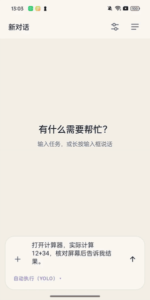
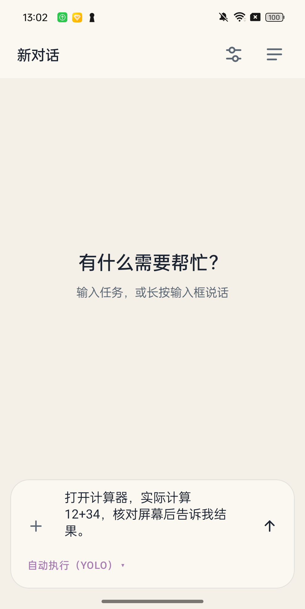
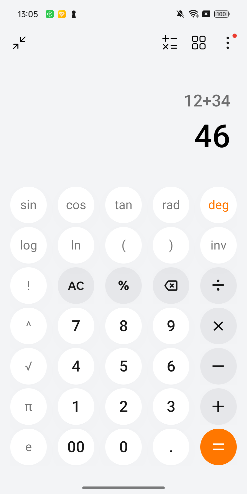
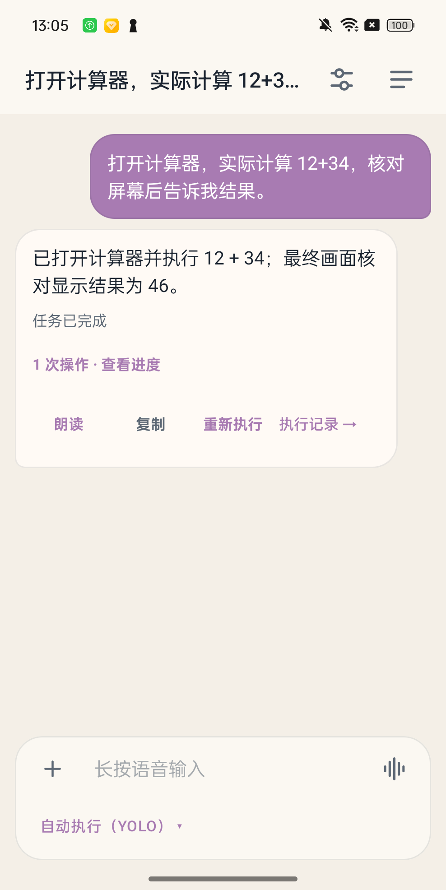
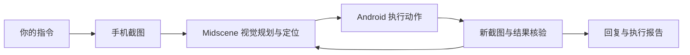

<p align="center"></p>

# Tapilot

**基于 [Midscene](https://github.com/web-infra-dev/midscene) 的纯视觉 Android 自动化。**

[English](README.md) · **简体中文**

用自然语言告诉 Tapilot 要做什么。Midscene 读取手机截图，理解画面、定位可见目标，
再执行下一步操作。Tapilot 把 Agent 放到 Android 手机上运行，提供原生聊天界面和
可回放的执行报告。

视觉导航基于截图，不依赖 DOM 选择器、控件资源 ID 或 UI 树定位。
Android `AccessibilityService` 提供截图、手势、系统导航和文字输入能力。
日常运行**不需要 ADB、Shizuku 或 root**。项目仍处于实验阶段，模型判断和设备操作都可能失败。

## 看它实际操作

发送：**“打开计算器，实际计算 12+34，核对屏幕后告诉我结果。”**
手机会打开计算器、完成计算，并返回 **46**。

[](docs/assets/demo.mp4)

**[观看／下载操作视频](docs/assets/demo.mp4)** · OPPO Find N 真机录制 · 静音延时视频 · 中文界面

| 输入指令 | Midscene 操作手机 | 查看结果 |
| --- | --- | --- |
|  |  |  |

## 纯视觉操作怎样完成



Midscene 负责视觉规划、目标定位、动作执行和报告。Tapilot 负责 Android 原生界面、
设备适配、模型请求、会话保存和任务生命周期。内置 Node.js 在手机上运行，
模型推理使用你配置的远程服务。**端侧编排不等于离线推理。**

无障碍服务承担设备执行，不是 Midscene 的视觉定位方式。原生文字编辑可能使用
已聚焦的可编辑无障碍节点；应用启动使用 Android 的应用清单。因此，即使画面可见，
自绘输入控件和受保护页面仍可能无法操作。

## 可以做什么

- **用自然语言操作应用。** 基于 Midscene 的截图理解，完成点击、滑动、滚动、输入、
  启动应用和应用切换。
- **连续完成跨应用任务。** 保留计划与操作结果，执行中追加要求，或明确停止后重试。
  应用重启后不会自动重放被打断的任务。模型只回复文字却不推进或结束任务时，会提示其调用工具；
  连续三次仍无进展则以失败结束，避免反复空转。
- 截图核验分别保留用户要求与模型提出的中间步骤，恢复任务时不把自选视图、布局或重复标签当成用户要求；用户追加条件进入后续核验。回复只保留所需事实和必要的不确定性，动态值以最新截图为准，正常时间变化不再描述为识别错误。
- 截图核验先在不提供成功条件的情况下读取可见事实，再结合当前画面检查目标；两次只读查询均保留报告，缺失证据仍视为未知。 回显提示词或格式错误最多补做一次只读核验，仍无有效结果则失败；有效的否定判断不会被覆盖。
- 模型请求在收到响应头前超时，可用新连接补一次相同请求，两次合计仍受原 120 秒期限限制，读取空闲上限为 60 秒。取消、认证拒绝和响应体读取超时不会触发此重试；网络层不会重放手机操作。
- **回看实际执行过程。** 在 Midscene HTML 报告中查看截图、模型计划、动作和错误，
  按需导出。
- **用语音交互。** 可选火山引擎或 Deepgram 转写与播报，分别配置服务凭据，支持自动朗读回答。
- **通过 Wi-Fi 控制手机。** 本地 [Android Use 插件](plugins/android-use/README.md)
  通过固定证书的 TLS 连接已配对手机。无线控制要求手机解锁并独占控制权，不需要 ADB 或 USB。

## 开始使用

需要 **arm64 架构、Android 11 或更高版本**的手机，以及支持的视觉模型。
目前尚无验证完成的公开发布流程，可按下方步骤构建开发 APK。

1. 安装 APK，打开 Tapilot，在 Android 无障碍设置中启用 **Tapilot 设备控制**。
2. 在 Tapilot 设置中配置 HTTPS 视觉模型 API，或在可用时选择现有的 ChatGPT（SIWC）
   连接方式。凭据只在手机内填写。
3. 先试计算器这样的简单可见任务，再查看真实画面和执行记录，核对结果。

输入框支持自动执行（YOLO）、关键操作确认和每次操作确认。
**新安装默认使用 YOLO。** 发送任务前，请根据任务选择合适的确认方式。

### 配置语音输入（可选）

在 **设置 → 语音输入** 中选择服务商。应用内也提供控制台和官方指南的跳转入口：

- **火山引擎：**登录并完成实名认证，在豆包语音中开通流式语音识别 2.0 服务，
  然后进入 [API Key 管理](https://console.volcengine.com/speech/new/setting/apikeys) 创建密钥。
  这里需要豆包语音 API Key，不能使用方舟模型密钥或旧版 APP ID。
  [官方指南](https://docs.volcengine.com/docs/DoubaoVoice/QuickStartNewConsole?lang=zh)。
- **Deepgram：**登录 [控制台](https://console.deepgram.com/)，选择项目，进入
  **Settings → API Keys → Create a New API Key**，创建允许语音转写的密钥。
  密钥只显示一次，请及时复制。
  [官方指南](https://developers.deepgram.com/docs/create-additional-api-keys)。

将密钥粘贴到应用中，点击 **检查连接** 即可保存并验证。

## 构建与开发

使用 Node.js 24、pnpm 12.4.1、JDK 17、Android SDK Platform 35 和 Build Tools 35.0.0，
设置 `JAVA_HOME`、`ANDROID_HOME`。完整主机依赖和签名配置见 [CONTRIBUTING](CONTRIBUTING.md)。

```sh
pnpm install --frozen-lockfile
npm ci --prefix plugins/android-use
npm ci --prefix tests/midscene
pnpm build:android
pnpm check:quick
```

本地 APK 位于 `app/build/outputs/apk/beta/app-beta.apk`，使用当前电脑的开发签名，
不能覆盖其他签名的安装版本。生产签名单独配置。开发者可以使用 ADB 安装和测试，
Tapilot 日常自动化不需要 ADB。

| 目录 | 用途 |
| --- | --- |
| `app/` | Android 原生界面、凭据、设备动作和生命周期 |
| `node-runtime/` | 内置 Pi Agent、Midscene Runner 和部署依赖 |
| `packages/android-accessibility/` | Android AccessibilityService 的 Midscene 适配器 |
| `plugins/android-use/` | 电脑端 Wi-Fi 控制插件 |
| `tests/midscene/` | 19 条 E2E 用例和显式开启的设备故障测试 |
| `legacy/web-ui/` | 历史 Web UI，普通 APK 不包含它 |

`pnpm check` 执行完整本地测试和构建检查，`pnpm check:security` 审计依赖。
真机 E2E 单独运行；写好了 19 条用例，不代表 19 条都已通过。
详见 [E2E 指南与验证记录](tests/midscene/README.md)、[架构说明](docs/architecture/README.md)
和 [开发指南](docs/development/README.md)。

当前有效证据与发布门禁见[验收入口](docs/development/validation-current.zh.md)。历史真机结果不代表最新源码已通过验收。

## 能力边界与数据

- 模型可能误读画面、推断未看到的信息，或错误地报告任务完成。目前设备信息的证据核对
  仍有已知问题，记录在 E2E 指南中。重要结果应以真实画面为准。
- 锁屏、受保护页面、厂商后台限制和无法通过无障碍输入的自绘控件，都可能中断执行。
  当前只内置 arm64 运行时。
- 截图和任务内容会发给你选择的模型服务。可选 ASR/TTS 会将音频或回答文本发给所选
  语音服务。账号令牌和 API Key 使用 Android Keystore 加密存储，但模型请求不会因此
  变为本地推理，也不会跳过服务商处理。
- 报告包含截图、指令和模型输出，分享前请检查。导出的报告和电脑插件数据分别管理，
  清除手机应用数据不会一并删除它们。

数据处理与删除方式见 [隐私说明](PRIVACY.zh.md)，传输、凭据存储和私下报告漏洞的方式见
[SECURITY.md](SECURITY.md)。

## 上游致谢

**[Midscene](https://github.com/web-infra-dev/midscene)** 是本项目视觉自动化、Android
设备适配集成、Test Runner 和执行报告的基础。

同时感谢 [Pi](https://github.com/earendil-works/pi) 提供对话与工具循环，
[Node.js](https://nodejs.org/) 和 [Termux](https://github.com/termux/termux-packages)
提供 Android 运行时，[Android Jetpack Compose](https://developer.android.com/compose)
提供原生界面，以及 [Model Context Protocol](https://github.com/modelcontextprotocol)
提供电脑插件协议。更多上游项目、许可证标识和发布前仍需完成的分发工作见
[CREDITS.md](CREDITS.md)。

## 许可证

采用 [MIT 许可证](LICENSE)。第三方组件继续遵循各自许可证，详见
[上游致谢](CREDITS.md)和[分发说明](docs/development/third-party-licenses.md)。
