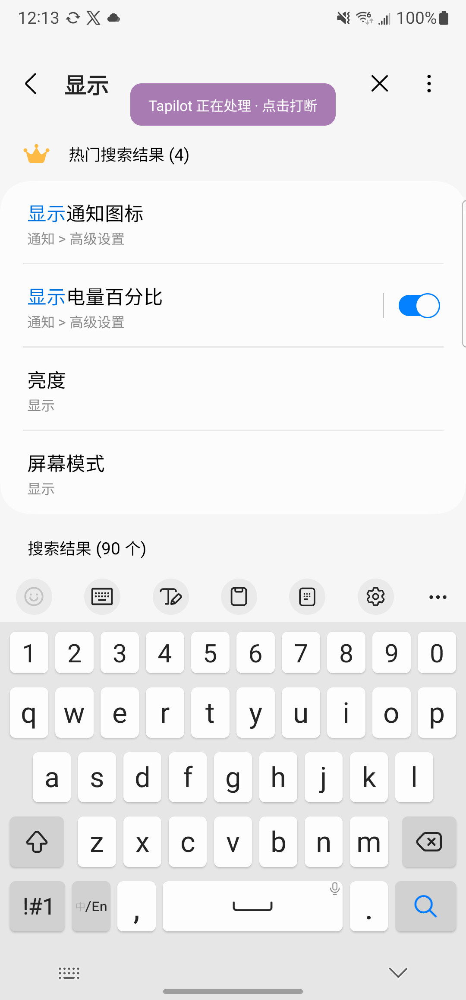
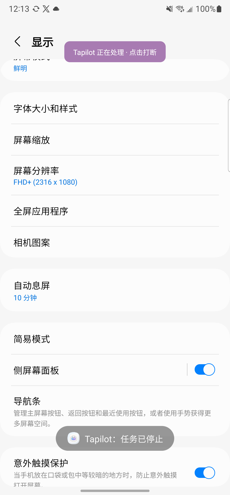
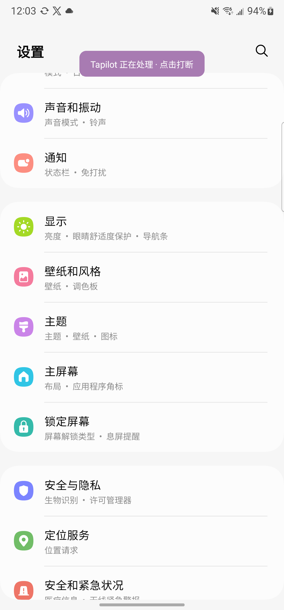
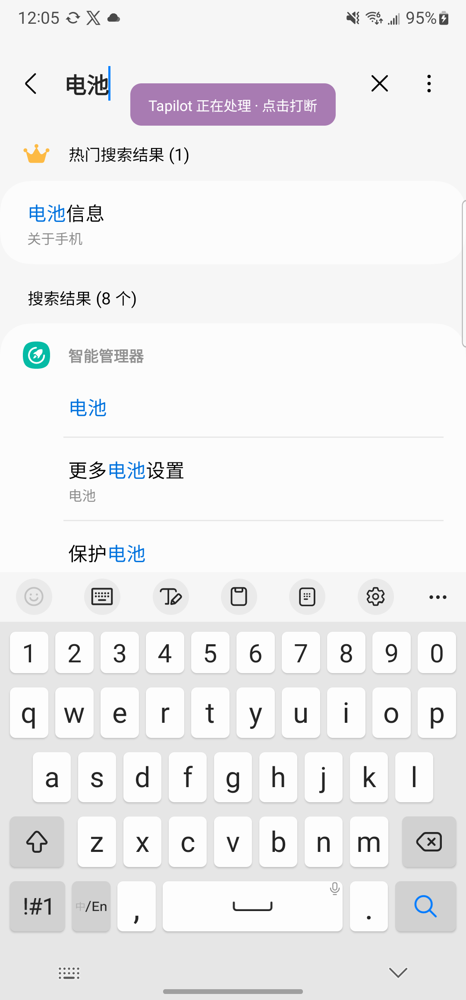
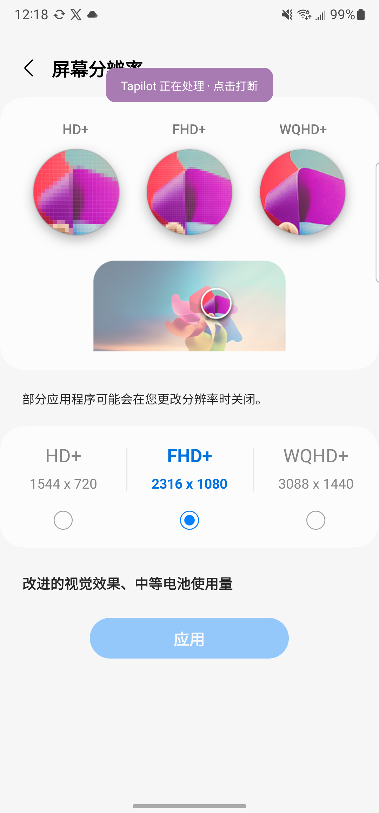
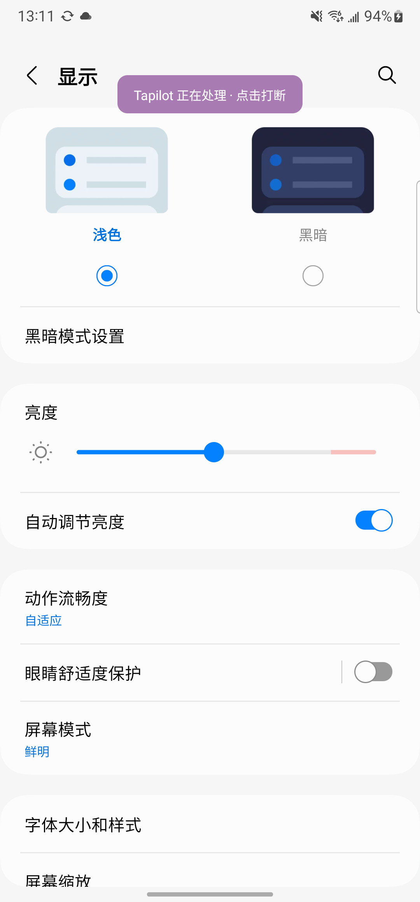
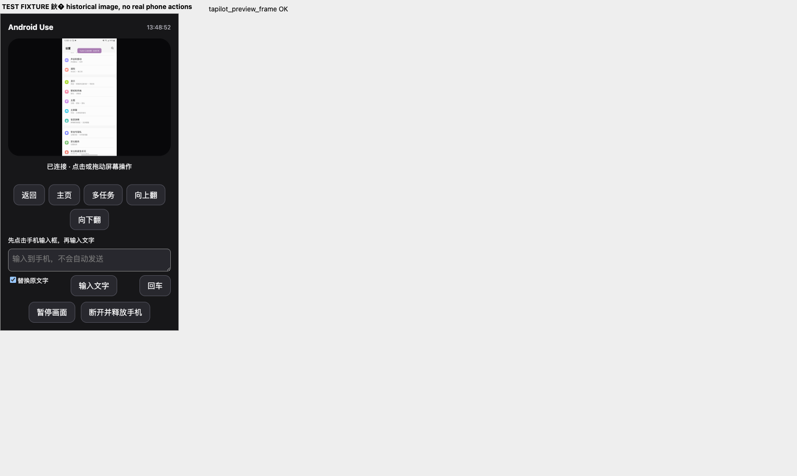

# Wireless control implementation evidence

Baseline: `e5dd7bf`. Implementation lives on `feat/wifi-mcp` in an isolated worktree
so concurrent ChatGPT account integration changes in the original checkout are
not overwritten. This record distinguishes protocol tests from physical-phone
acceptance. Cable-free control through the installed MCP artifact passed; fresh Codex app-server discovery and direct tool calls also passed. The current
ChatGPT conversation has not refreshed its own tool inventory.

## Automated checks

- `:app:testDebugUnitTest`: 172 tests, 171 passed, 1 pre-existing optional live
  speech-provider test skipped, no failures/errors.
- `:app:assembleDebug`: passed.
- `:app:assembleDebugAndroidTest`: passed, including pairing-fixture cleanup.
- `npm test --prefix plugins/android-use`: six tests passed. These exercise a real
  stdio MCP SDK client and a TLS fixture, including screenshot image content,
  pin mismatch (no credential sent), bad credentials, disconnected mutations not
  retried, schema validation, and mode-0600 credential storage.
- `git diff --check`: passed.

## Physical device findings

Device: Samsung SM-N9860, Android 13. Debug APK installed with `adb install -r`;
no app-data reset and no ADB TCP mode or port forwarding was used.

- Earlier network probe: computer reached a temporary phone TCP listener through
  the phone's Wi-Fi interface and received an exact nonce echo. This was a shell
  process and is only network reachability evidence.
- Actual Tapilot TLS server: certificate-pinned one-time pairing succeeded over
  Wi-Fi. The permanent credential was saved privately on the computer and was
  not printed into logs or the conversation.
- Initial RSA Keystore identity failed on the Samsung Conscrypt path with
  `Incompatible padding mode` / `RSA/ECB/NoPadding`. The implementation uses a
  P-256 ECDSA Keystore identity instead, with `DIGEST_NONE` authorized because
  Conscrypt supplies an already-hashed TLS transcript. The ECDSA pairing was
  successful; TLS and fingerprint validation were retained.
- MCP status reached the phone and correctly reported that its accessibility
  service was disconnected. Instrumentation restarts the app process and can
  leave that service enabled but unbound on this device.
- Follow-up physical acceptance succeeded on October 13, 2026, 11:59–12:05
  Asia/Shanghai. The harness ran the **installed plugin cache artifact**, using
  the official MCP SDK client over stdio. The plugin connected directly to the
  phone's Wi-Fi TLS endpoint. No ADB input or screenshots were used for the
  functional actions below (ADB was used only for installation/setup).
- Verified by inspecting actual MCP PNG image responses:
  - Launch Android Settings and open its search field with a screenshot-based tap.
  - Enter Chinese `电池`; the screen shows the query and eight search results.
  - Swipe the Settings list; the visible entries change from Connection / Connected
    devices to Display / Wallpaper / Location services.
  - Tap Location services near the bottom of the screen; its detail page opens.
    No setting toggle was changed.
  - Explicitly disconnect, reconnect with the saved credential, press Back, and
    capture the returned Settings list.
- A second installed-plugin process was rejected with `Another task is already
  registered`. The original connection continued working. Reusing an old frame
  was rejected with `Stale frame. Capture a new screen.`
- Screenshots in the final run took 368–560 ms, taps 176–228 ms, Chinese input
  129 ms, and a 600 ms swipe took 771 ms. These are observed samples, not a
  latency guarantee.
- Capture metadata initially reported 1080×2210 logical size for a 1080×2316 PNG.
  The existing inverse gesture scaling compensated on the tested wireless path,
  but the metadata itself excluded system bars. Capture, frame validation,
  device size, and native gesture scaling now share full-display logical metrics.
  The final device reports 1080×2316 consistently, with successful top/bottom
  taps, swipe, Chinese input, and reconnect on the rebuilt APK. Android's
  [Display API](https://developer.android.com/reference/android/view/Display#getRealMetrics(android.util.DisplayMetrics))
  documents the full-display metrics used here.
- Final installed APK SHA-256:
  `2cb26c6f9827410bfe588e4b2247f1dccf03376a3075307fb44c8341f3c654d3`.
- **Physical USB removal passed**, October 13, 2026, 12:12–12:14 Asia/Shanghai:
  the user unplugged the phone and `adb devices -l` no longer listed Samsung
  serial `R5CN90V1AYP` (only an unrelated device and emulator remained).
  A new installed-plugin process authenticated using the existing pairing over
  Wi-Fi, then returned a fresh 1080×2316 screen.
- Without USB, changed the focused search field to Chinese `显示` (126 ms).
  The next screenshot shows `显示`, four popular results, and 90 search results.
  Tapped the visible screen-mode result (255 ms), and a screenshot confirmed
  the Display settings page opened. Swiped its list (765 ms), explicitly
  disconnected, then reconnected through `tapilot_screen` (727 ms including
  connection). The returned screenshot shows the lower Display settings list,
  including resolution, timeout, navigation bar, and accidental-touch protection.
  No setting toggles were changed. USB inventory was checked again at cleanup.
- Cable-free screenshots took 538–567 ms on this run. Testing used the actual
  installed stdio MCP plugin with an SDK host, not ChatGPT's native tool picker.

## Installed desktop artifact

The plugin was renamed **Android Use** at the user's request. The old
`tapilot@tapilot-local` install was replaced with
`android-use@android-use-local` version 0.1.0. Plugin root is now
`plugins/android-use`; the MCP server key is `android_use`. The phone app,
existing pairing file, and `tapilot_*` tool names are retained for compatibility.
All six plugin tests passed after the rename.

On October 13, 2026, 12:17–12:19 Asia/Shanghai, a fresh `codex app-server`
process discovered all eight tools through `mcpServerStatus/list`, reporting
`pluginId=android-use@android-use-local` and no tools error. This used installed
plugin discovery, with no manually injected MCP server configuration.
An ephemeral host thread (no model turn or additional agent) then called
`mcpServer/tool/call`: screenshot → tap Screen resolution → screenshot. The
returned image confirmed the phone opened its Screen resolution page with the
existing FHD+ selection. The test pressed Back and disconnected afterward.
Samsung serial `R5CN90V1AYP` remained absent from the USB device inventory.

This proves the fresh Codex host's discovery and invocation path. The already
open ChatGPT conversation still has no Android Use tool in its injected inventory;
its tool-picker UI and automatic model selection are not claimed as tested.

## Remaining acceptance

1. Open a fresh ChatGPT conversation and verify the visible tool picker and
   model-selected invocation. Fresh Codex app-server discovery/calls passed above.
2. Verify local-task exclusion, notification stop, and revocation on the device.
3. Verify Android 14+ connected-device service behavior and idle/network-change
   behavior on additional OS/device combinations. No always-on Doze guarantee.

## Version 0.2.0: unlock interaction and MCP App preview

Implemented a bundled `ui://android-use/screen-0.2.0.html` App, matching the
resource/metadata convention used by the sibling iPhone Use project. A stable
widget session ID requests panel reuse. Host layout support determines whether
it opens in the right-side/fullscreen surface. App-only frame/resume tools return
preview data in structured content, separately from model screenshots.

The phone's new `device.preview` method captures without replacing the actionable
frame. Native capture and its retries carry `recordFrame=false` for this path;
normal captures retain the existing behavior. Locked devices are rejected before
and after wireless captures. Preview polls are serialized with model operations.
The UI polls at one second intervals plus capture latency, clears images on
lock/pause/disconnect, and stops polling while hidden or torn down.

Model tools encountering a locked phone request MCP form elicitation when
supported, with the actual `已完成继续` answer required. Unsupported hosts receive
an explicit interactive-question fallback instruction. Only an observation may
be retried once; no mutation is replayed. The device queue is released while
waiting for the answer, so preview polls can observe the lock state. A newer
manual pause or disconnect prevents an old dialog from resuming capture.

Validation:

- Ten plugin tests pass, including a real MCP client lock→elicitation→confirmation
  →fresh observation cycle, preview polling during the dialog, cancellation,
  mutation non-replay, privacy-pause precedence, and resource discovery/read.
- Android unit tests and `assembleDebug` pass (171 passed, one existing skip).
- Installed plugin 0.2.0: a fresh Codex app-server discovers all eleven tools,
  including two App-only tools, and reads the offline HTML resource with the
  expected MIME type, empty network CSP lists, and fullscreen metadata.
- Built APK SHA-256:
  `7114d3491ee3e79f9d110acc14e891fdddbe7ac831a68ff487b30ee1ed62b8e7`.
- **Pending:** install this APK on the Samsung, exercise preview between a model
  screenshot and tap, physically lock/unlock while observing the interaction,
  and verify the actual ChatGPT side-panel renderer. The Samsung was still
  absent from USB inventory after requesting a temporary reconnection. Neither
  live-panel rendering nor real-device unlock interaction is claimed passed.

### Physical follow-up, 13:10–13:13 Asia/Shanghai

The user reconnected and unlocked Samsung `R5CN90V1AYP`. Installed the 0.2.0
supporting APK above with `adb install -r`, preserving data. Accessibility bound
normally; wireless mode was enabled through the normal settings UI.

A fresh Codex app-server called the installed plugin over Wi-Fi:

1. Capture model frame `9da0cb95-9037-430c-b235-b3c786c662fa` in Settings.
2. Read two `tapilot_preview_frame` responses, both `state=live`, with advancing
   capture timestamps (1791868253397 and 1791868254080).
3. Tap Display using the original model frame ID after both preview refreshes.
4. Capture confirmed Display settings opened. Preview did not invalidate the
   actionable screenshot.

For lock acceptance, test setup sent Android's sleep key. The next preview
returned `state=device_locked` without image data. A model screenshot call caused
Codex app-server to emit `mcpServer/elicitation/request`, mode `form`, with the
Chinese manual-unlock message and `已完成继续` choice. This is an actual host
elicitation event, not merely tool instructions. Completion remains pending the
user's actual unlock response.

An additional observation: a new TLS connection while the phone was dozing timed
out, despite the Wi-Fi address and foreground wireless service remaining present.
Waking the screen (without unlocking) restored connectivity and produced the
correct unlock elicitation again. This version does not guarantee screen-off
network availability; connection timeouts are not treated as proof of a lock.
The actual ChatGPT side-panel renderer still requires a refreshed conversation.

### Interactive panel 0.3.0, 2026-10-13 13:50 Asia/Shanghai

Added click-to-tap, drag-to-swipe, navigation/scroll buttons, Chinese text input,
separate Enter, and explicit disconnect/release. A panel frame expires after ten
seconds and is consumed by an action. The server takes a fresh native capture
before a single manual mutation and rejects changed screenshot dimensions. Model
mutations invalidate pending panel coordinates. A hidden panel cancels gestures.
Browser-native image dragging is disabled so it cannot steal phone gestures.
Privacy pause/disconnect clears the displayed image before waiting for the server.

Connection messages now distinguish another controller, pairing failure, lock,
privacy pause, and network unavailability. Error notices survive frame refreshes.
TCP keepalive and no-delay are enabled; this is NOT a fix for Android Doze or a
guarantee of continuous screen-off connectivity.

Validation:

- 18 plugin tests pass. Coverage includes real MCP stdio control dispatch, fresh
  native frame use, duplicate rejection, coordinate bounds/letterboxing, rotation,
  Chinese input without submission, disconnect non-replay, and unlock elicitation.
- Bundled UI built successfully. Browser fixture verified Home, pointer tap, drag,
  Chinese input, text clearing, pause/resume, and disconnect. A 375×667 dark/reduced-
  motion view has no horizontal overflow. The browser uses a historical Settings
  image and mock device, explicitly labelled; these are NOT new phone actions.
- Ego's higher-level mouse input toggled document visibility between pointer down
  and up, correctly cancelling gestures. Browser CDP pointer events verified the
  gesture handlers without that harness interference; form/button handlers were
  exercised through the DOM.
- Installed 0.3.0 in the local plugin cache. A fresh Codex app-server discovered
  all 12 tools with no tool discovery error; the control tool is App-only. Direct
  MCP discovery returned `ui://android-use/screen-0.3.0.html`.
- Earlier an existing ChatGPT-owned 0.2.0 process held the Samsung connection. It
  was not killed. The final native-host and direct installed-plugin observations
  both timed out connecting to the phone, returning `state=unavailable`. This final
  timeout does not establish controller occupancy or a locked screen.
- **Pending:** real-phone validation of the new interactive panel, and actual
  ChatGPT side-panel rendering after reloading the plugin. User was asked to
  release the old session or cycle wireless control. No new phone-action success
  or resolved disconnection claim is made. The Android APK was not changed.

### Follow-up: fitted screen and persistent preview, 0.3.2

The preview image now sizes to its intrinsic aspect ratio on a transparent stage,
following iPhone Use's fitted-device layout. A browser measurement found a
224.0625×480.484375 image for a 1080×2316 source, with a transparent stage; there
are no wide black side panels. Existing gesture coordinate tests remain valid.

After the user authorized releasing the old connection, the stale 0.2.0 plugin
process was stopped. The current host successfully captured the actual Samsung
over Wi-Fi. The production preview/control modules were then exercised through
a local browser AppBridge test host against the real phone: clicking About phone
in the preview visibly opened About phone on Galaxy Note20 Ultra 5G. This is real
phone input through the panel, not the earlier mock fixture. ChatGPT's own sidebar
renderer remains a separate reload/acceptance step.

Per user instruction, the server instructions and disconnect-tool description
now keep the screen open on task completion. Disconnect is explicit-user-only;
phone/network interruption and idle timeout remain possible.

### Midscene physical acceptance, 2026-10-13 15:01–15:06 Asia/Shanghai

- Reinstalled the previously verified supporting APK on Samsung `R5CN90V1AYP`
  with `adb install -r`: Success. Package `lifeos.md.tapilot`, versionCode 8,
  versionName 0.1.7. Data and accessibility authorization were preserved. This
  phone APK version is separate from the desktop plugin version.
- Installed desktop Android Use 0.4.1. The default TCP route to the paired phone
  timed out through `utun8`; binding the connection to physical `en0` succeeded.
  A Node TLS source-address binding resolved the actual pairing connection
  without changing system routes. Twenty-six local tests pass.
- A direct SDK MCP host loaded the **installed 0.4.1 cache artifact**, connected
  over Wi-Fi, executed `tapilot_midscene` screenshot, launch of
  `com.android.settings`, tap on Connections, and a fresh screenshot. The final
  image visibly showed the Connections page. Initial launch capture caught an
  animation; only the subsequent observation was used for choosing coordinates.
- Native report: `~/.local/share/android-use/midscene_run/report/android-use-samsung-20261013-midscene.html`.
  Screenshots remain private; no account/settings screenshots are committed.
- USB was connected for installation during this test, but the MCP control
  transport was the pinned TLS Wi-Fi endpoint, not ADB. This is not a new
  cable-unplugged acceptance run.
- ChatGPT started 0.4.1 processes after the user reloaded, but this existing
  conversation retained its old 0.3.0 tool connection. Computer Use denies access
  to the ChatGPT application, so native ChatGPT UI acceptance is not claimed.
- The temporary direct test connection initially competed with the user's
  sidebar reconnect. It was closed to hand ownership back to the sidebar; socket
  inventory then showed no remaining controller. User-visible reconnect outcome
  is pending. The phone's wireless service remains enabled.
- Real ChatGPT-authorized Midscene AI is pending independent consent. The tested
  real-phone actions used steps mode (`decision_source=chat_host`).
